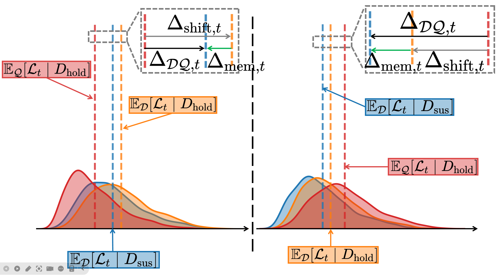

# LDM-DI

## Overview of our work

Since most open-source community or commercial models tend not to disclose training set details, it raises privacy and copyright concerns on utilizing unlicensed
proprietary data to train these models. Recent researches have focused on membership inference methods to detect training samples of diffusion models and exposes evidence of misusing unlicensed dataset.

In this paper, we first analysis MIA's failure on pre-trained large-scale diffusion models due to the conflation of true training-set membership with distribution shift between evaluation datasets. Further, we propose a more realistic evaluation framework that mitigates distribution shift between candidate datasets. Finally, we introduce a dataset inference method beyond individual samples and instead infers whether an image dataset was used in pre-training.

### Why MIAs Failed on Pre-trained Large-scale Diffusion Models?

Ideal Membership Inference. Given a target diffusion model $f_{\theta}$, unlicensed set $D_{\text{sus}}$ suspected to be training data and known hold-out set $D_{\text{hold}}$, the detector executes a hypothesis testing:

$$
\begin{align}
 H_0&: D_{\text{sus}}~\text{is not included in the training data of}~f_{\theta} \nonumber\\
 H_1&: D_{\text{sus}}~\text{is included in the training data of}~f_{\theta} \nonumber
\end{align}
$$

Existing MIAs typically reduce this dataset-level problem to a collection of independent sample-level binary classification tasks. However, MIAs failed because of large distribution shift gap bwtween two evaluation datasets and weak memorization of large diffusion models on individual samples:



### Mitigate Distribution Shift Between $D_{\text{sus}}$ and $D_{\text{hold}}$

We propose a KNN-based mitigation on CLIP embedding space (**CLIP-KNN**) to obtain distributionally similar evaluation datasets $D_{\text{sus}}$ and $D_{\text{hold}}$. And we quantify distribution similarity from both semantic space and texture complexity.

### Solution: A Dataset Inference On Pre-trained Large-scale Diffusion Models


Finally, we perform a dataset inference as a more realistic method to detect whether unlicensed dataset is suspected to be used in target diffusion model’s training
data. **(1)** For $D_{\text{sus}}$ and $D_{\text{hold}}$, we split each of them into disjoint blocks $A$ and $B$. **(2)** Then, we aggregate sample-level membership features for blocks $A$ and $B$. **(3)** Subsequently, we train a linear model through the aggregated features of training block $A$ and hold-out block $A$. This model predicts membership probability scores for each sample in training block $B$ and hold-out block $B$. **(4)** Eventually, a mean Welch’s T-Test calibrated by dynamic thresholds on the two $B$ sets is conducted to get reliable evidence for membership sets. **(5)** After multiple independent T-Test, we will significantly reject the null hypothesis.

---

## Start Experiment

### Requirements

Runtime Environmemt is listed in ```src/requirements.txt```. We use following environment configurations:

+ One NVIDIA RTX PRO 6000 GPU

+ PyTorch 2.8.0

+ Python 3.12 (Ubuntu 22.04)

+ CUDA 12.8

### Configurations

All our experiment parameter comfigurations are defined in ```src/exp_utils/src/exp_utils/config_util/attack_config.py```

### Start experimental framework

#### 1. Get all datasets you need

First, run code in ```dataset/``` to get each full training dataset and hold-out dataset. To clean bad downloaded images, use ```dataset/clean_bad_images.py```

#### 2. Run CLIP-KNN and evaluation

After datasets obtained, run ```src/exp_utils/dataset_process_util/clip_knn.py```to mitigate distribution shift to get a pair of $D_{\text{sus}}$ and $D_{\text{hold}}$ with similar distributions. Use ```src/exp_utils/dataset_process_util/cls_test.py``` to evaluate distribution similarity  via the binary classifier and ```src/exp_utils/dataset_process_util/complex_test.py``` via image texture complexity.

#### 3. Run dataset inference

Finally, run ```src/dataset_inference.py``` to execute the dataset inference based on distributionally similar $D_{\text{sus}}$ and $D_{\text{hold}}$, and ```src/reject_H0_analysis.py``` for determining dynamic calibration threshold and whether to reject the null hypothesis.

---

#### Additional: Run Single Membership Inference Attack

Use ```src/exp_utils/mi_util/baseline_mi_main.py``` to independently run each MIAs used to extract memorization features used in dataset inference.

To run our MI feature methods, use ```src/exp_utils/mi_util/ours_mi_main.py```.

#### Models and Datasets

All pre-trained models are available in their official repo as follows:

[stable-diffusion-v1-5/stable-diffusion-v1-5 · Hugging Face](https://huggingface.co/stable-diffusion-v1-5/stable-diffusion-v1-5)

[common-canvas/CommonCanvas-S-C · Hugging Face](https://huggingface.co/common-canvas/CommonCanvas-S-C)

[kandinsky-community/kandinsky-3 · Hugging Face](https://huggingface.co/kandinsky-community/kandinsky-3)

Dataset are available as follows:

[laion/aesthetics_v2_4.75 · Datasets at Hugging Face](https://huggingface.co/datasets/laion/aesthetics_v2_4.75)

[laion/relaion-high-resolution · Datasets at Hugging Face](https://huggingface.co/datasets/laion/relaion-high-resolution)

[laion/relaion2B-multi-joined-translated-to-en · Datasets at Hugging Face](https://huggingface.co/datasets/laion/relaion2B-multi-joined-translated-to-en)

[COCO - Common Objects in Context](https://cocodataset.org/#download)

[common-canvas/commoncatalog-cc-by · Datasets at Hugging Face](https://huggingface.co/datasets/common-canvas/commoncatalog-cc-by)

[HuggingFaceM4/NoCaps · Datasets at Hugging Face](https://huggingface.co/datasets/HuggingFaceM4/NoCaps)
