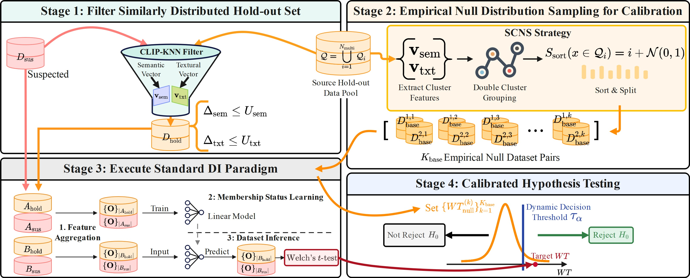

# LDM-DI

## Abstract
The rapid adoption of pre-trained diffusion models has heightened concerns that these models may have been trained on unlicensed or proprietary datasets. 
Existing approaches for copyright detection are largely based on Membership Inference Attacks (MIAs).
However, due to the nature of training large-scale diffusion models on massive training data, these models retain only a weak memorization of individual samples, rendering typical sample-level MIAs nearly ineffective.
To overcome the fundamental limitations of sample-level MIAs, recent studies have focused on Dataset Inference (DI), which leverages aggregated MIA features to improve performance. Yet, such approaches rely on the strict Independent and Identically Distributed (IID) assumption, which is difficult to satisfy in practical copyright detection scenarios due to distribution shifts across detection datasets.
To address the challenges of applying DI in real-world scenarios, in this paper, we theoretically break the strict IID assumption and propose a more realistic similar distribution assumption, quantifying the residual distribution shift in both the semantic and textural spaces. Based on this assumption, we propose a calibration DI framework for real-world detections and theoretically bound the false positive rate (FPR) under residual distribution shift. 
Extensive experiments demonstrate that our method maintains detection efficiency while suppressing the FPR in real-world scenarios.



---

## Start Experiment

### Requirements

Runtime Environmemt is listed in ```src/requirements.txt```. We use following environment configurations:

+ One NVIDIA RTX PRO 6000 GPU

+ PyTorch 2.8.0

+ Python 3.12

+ CUDA 12.8

### Configurations

All our experiment parameter comfigurations are defined in ```src/exp_utils/config_util/attack_config.py```

### Start experimental framework

#### 1. Get all datasets you need

First, run code in ```dataset/``` to get each full training dataset and hold-out dataset. To clean bad downloaded images, use ```dataset/clean_bad_images.py```

#### 2. Run CLIP-KNN and SCNS

After datasets are obtained, run ```src/exp_utils/dataset_process_util/clip_knn.py```to mitigate distribution shift to get a pair of $D_{\text{sus}}$ and $D_{\text{hold}}$ with similar distributions. Use ```src/exp_utils/dataset_process_util/seman_bound.py``` to evaluate distribution similarity  via the binary classifier and ```src/exp_utils/dataset_process_util/texture_bound.py``` via image textural complexity.

Run ```src/exp_utils/dataset_process_util/emp_null_sample.py``` to generate hold-out subset pairs using SCNS.

#### 3. Run dataset inference

Finally, run ```src/main_ttest.py``` to execute the dataset inference based on distributionally similar $D_{\text{sus}}$ and $D_{\text{hold}}$, and ```src/calculate_threshold_fpr.py``` for calculating dynamic calibration threshold and whether to reject the null hypothesis.

Additionally, ```src/baseline_ttest.py``` is the standard DI paradigm, along with ```src/baseline_calculate_fpr.py``` for evaluating FPR and TPR.

---

#### Additional: Run Single Membership Inference Attack

Use ```src/exp_utils/mi_util/baseline_mi_main.py``` to independently run each MIAs used to extract memorization features used in dataset inference.

#### Models and Datasets

All pre-trained models are available in their official repo as follows:

[stable-diffusion-v1-5/stable-diffusion-v1-5 · Hugging Face](https://huggingface.co/stable-diffusion-v1-5/stable-diffusion-v1-5)

[common-canvas/CommonCanvas-S-C · Hugging Face](https://huggingface.co/common-canvas/CommonCanvas-S-C)

[kandinsky-community/kandinsky-3 · Hugging Face](https://huggingface.co/kandinsky-community/kandinsky-3)

Dataset are available as follows:

[laion/aesthetics_v2_4.75 · Datasets at Hugging Face](https://huggingface.co/datasets/laion/aesthetics_v2_4.75)

[laion/relaion2B-multi-joined-translated-to-en · Datasets at Hugging Face](https://huggingface.co/datasets/laion/relaion2B-multi-joined-translated-to-en)

[COCO - Common Objects in Context](https://cocodataset.org/#download)

[common-canvas/commoncatalog-cc-by-sa · Datasets at Hugging Face](https://huggingface.co/datasets/common-canvas/commoncatalog-cc-by-sa)

[HuggingFaceM4/NoCaps · Datasets at Hugging Face](https://huggingface.co/datasets/HuggingFaceM4/NoCaps)
